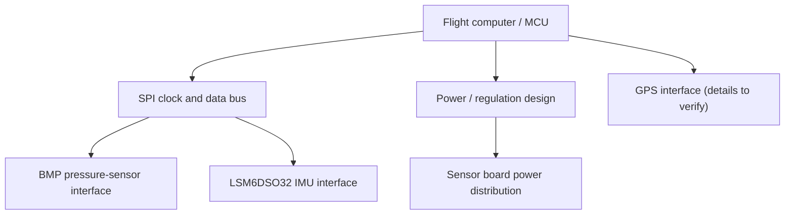

# Avionics Sensor Board

Central hardware repository for the avionics team's multi-sensor PCB.

This repository is organized so team members can develop and review individual sensor circuits independently while maintaining one controlled design for the integrated sensor board.

## Goals

- Consolidate individual sensor designs in one repository
- Keep each sensor circuit modular and easy to review
- Standardize power, SPI communication, and MCU interfaces
- Maintain a controlled integrated KiCad project
- Preserve design decisions, datasheets, manufacturing files, and test results
- Make collaboration and revision history easier through Git and GitHub

## Repository Structure

```text
Avionics-Sensor-Board/
├── hardware/
│   ├── sensors/             # Individual sensor designs
│   ├── power/               # Power regulation/distribution
│   ├── communications/      # Shared SPI bus and communication circuitry
│   └── sensor_board/        # Final integrated KiCad PCB project
├── libraries/               # Shared KiCad symbols, footprints, and 3D models
├── docs/                    # Architecture, requirements, datasheets, reviews
├── manufacturing/           # Gerbers, BOM, pick-and-place, assembly outputs
├── testing/                 # Bring-up procedures and test results
└── firmware/                # Hardware-test firmware and sensor drivers
```

## Communication Architecture

SPI is the board-standard sensor interface.

Shared bus lines are expected to include:

- `SPI_SCK`
- `SPI_MOSI`
- `SPI_MISO`

Each SPI peripheral should have its own dedicated chip-select signal. Interrupt lines should be routed separately where required.

## Recommended Design Flow

1. Develop each sensor circuit in its own folder under `hardware/sensors/`.
2. Document the sensor supply, SPI signals, supporting circuitry, and owner.
3. Run a peer schematic review.
4. Verify custom symbols and footprints against manufacturer documentation.
5. Integrate the approved design into `hardware/sensor_board/`.
6. Perform ERC and design-rule checks.
7. Assign and verify footprints.
8. Complete PCB layout.
9. Perform a PCB design review.
10. Generate manufacturing outputs.
11. Assemble and complete board bring-up.
12. Store test results under `testing/`.

## Sensor Status

The table below reflects **files present on the public default branch**, not completed hardware testing. Branch-only changes may be newer.

| Design | Source on `main` | What can be verified | Hardware validation |
|---|---|---|---|
| BMP sensor | [BMP unit schematic](hardware/BMP_unit.kicad_sch) | KiCad schematic present | No published test result found |
| LSM6DSO32 IMU | [IMU KiCad project](hardware/LSM6DSO32_schematic/) | Schematic, PCB and project files present | No published test result found |
| GPS | [GPS board project](hardware/GPS%20board/) | Schematic, PCB and project files present | No published test result found |
| Integrated sensor hat | [ESP32 Sensor Hat design](hardware/sensor_board/) | KiCad schematic, PCB and project files present | No signed-off bring-up found |
| Power distribution | [Power folder](hardware/power/) | Planning documentation present | Not verified |

See [Design Evidence Index](docs/DESIGN_EVIDENCE.md) for direct links and how to inspect the actual CAD sources.

## System Context (Conceptual)

The intended interface is a multi-sensor PCB connected to a flight computer; this block diagram illustrates the planned topology, **not a verified PCB netlist**.



## Contributions, Limitations and Next Steps

This is a **collaborative University of Houston rocketry avionics project**. Work includes sensor-interface development and KiCad/Git collaboration. Individual design ownership should be checked against commit and branch history before assigning credit for complete subsystems.

The public repository contains CAD design artifacts, but the existing [bring-up checklist](testing/bringup/bringup_checklist.md) is unchecked and the [electrical requirements](docs/requirements/electrical_requirements.md) include unresolved values. The README therefore does not claim completed electrical validation, manufactured boards, or flight qualification.

**Suggested next evidence:** ERC/DRC screenshots, PCB 3D renders, verified rail measurements, and SPI/sensor bring-up logs when approved for publication.

**[Return to engineering portfolio](https://github.com/LezigaBeage/Leziga_Portfolio)**


## Branching

Keep sensor-specific work on feature branches until it is ready for review.

Suggested branch names:

```text
feature/<sensor-name>
feature/power
feature/interfaces
feature/pcb-layout
fix/<short-description>
docs/<short-description>
```

Open a pull request when a design is ready for team review.

See [CONTRIBUTING.md](CONTRIBUTING.md) for the team workflow.
